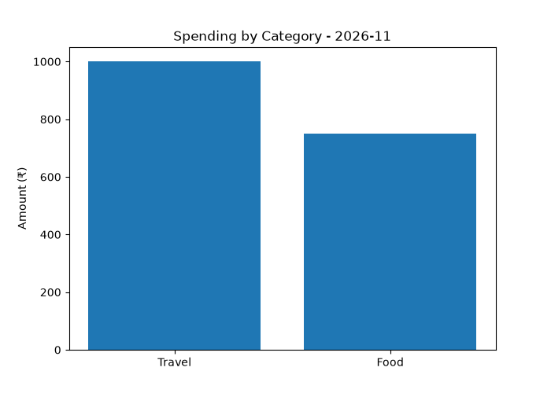

# Expense Tracker (Python + SQLite)

A command-line expense tracker built with Python and SQLite. Add, view, edit, and delete expenses, then see a monthly spending summary by category with a bar chart.

## Features
- Add expenses with amount, category, note, and date (auto-filled)
- View all expenses in a formatted table
- Edit and delete expenses by ID
- Monthly summary by category with percentage share of total
- Bar chart of spending by category (matplotlib)
- Input validation, so wrong input doesn't crash the program

## Tech
Python 3, SQLite (`sqlite3`), matplotlib

## How to run
pip install -r requirements.txt
python main.py

The database file (`expenses.db`) is created automatically on first run.

## Project structure
- `db.py`: all database logic (create table, add, update, delete, monthly summary)
- `main.py`: menu, user input, and chart
- Queries use parameterized SQL (`?` placeholders) to keep input separate from the query

## What I learned
- Separating database code from user interface code
- Writing SQL with GROUP BY and date filtering
- Handling invalid input with try/except

## Possible improvements
- Export to CSV or Excel
- Budget limits per category
- A simple web or GUI version

Built by Rishika | [GitHub](https://github.com/rishika182)